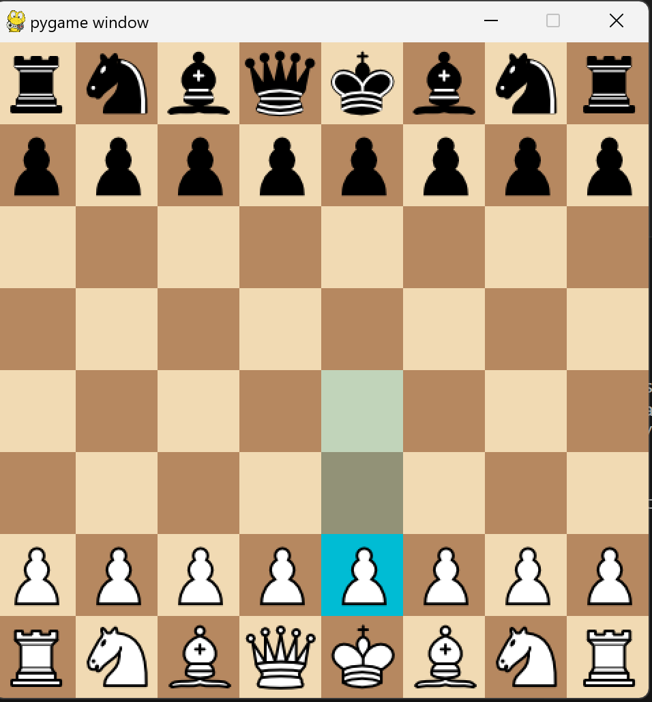
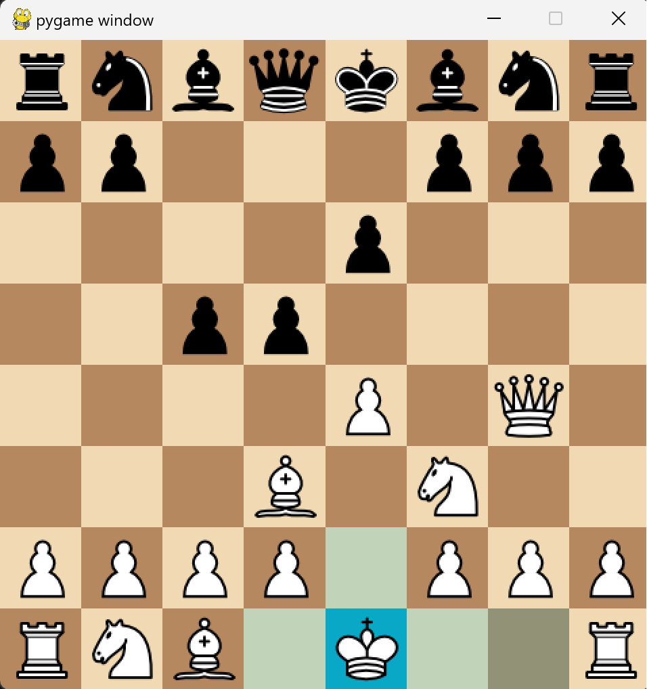

# Chess in Python and Pygame

> **Archived.** Superseded by [chess-engine](https://github.com/VarunAgarwalOfficial/chess-engine), the Rust rewrite with UCI and a browser board. This repository is kept as a record and is read-only.

A chess game written in Python with Pygame. It began in 2021 as a two-player game with full legal-move generation (castling, en passant, promotion, check, checkmate and stalemate), and now also has a computer opponent, a short tutorial and a set of puzzles.




The screenshots show the original interface. The current version uses a different colour scheme and adds a side panel with move history, captured pieces and an evaluation bar.

## Why it is interesting

- **Legal moves without trial and error.** Instead of playing every move and checking whether the king is left in check, the move generator works out the constraints first. `is_pinned` walks outwards from the king in each of the eight directions: if the first piece it meets is the one being moved and the next is an enemy bishop, rook or queen on that line, the piece is pinned and may only move along that line.
- **Answering check geometrically.** In double check only the king may move. A knight or pawn check can only be answered by capturing the checker. For a check from a sliding piece, a move is kept only if its target lies on the ray from the king to the checker and no further away than the checker, which means it either blocks or captures. King moves are tested by lifting the king off the board and asking whether the target square is attacked.
- **Computer opponent.** Minimax with alpha-beta pruning, iterative deepening, quiescence search, a transposition table and move ordering, evaluating material and piece-square tables. The four difficulty levels set the search depth from 2 to 5.

## Run it

Requires Python 3.8 or later.

```bash
pip install -r requirements.txt   # pygame, numpy
python run.py
```

The main menu offers Player vs Player, four levels against the computer, a tutorial (piece moves, special moves, basic tactics and endgames), puzzles and a help screen.

- Click a piece, then click a highlighted square to move it.
- `Z` undoes the last move.
- `R` or `Esc` returns to the menu.

Tests (checkmate, stalemate, insufficient material, special moves, undo and the computer opponent):

```bash
python tests/tests.py
```

## Tech

Python, Pygame and NumPy.

## Context

Personal project, 2021 (the two-player game). Restructured in 2024 and extended in November 2025 with the computer opponent, tutorial and puzzles. A later engine written in Rust, with a board that runs in the browser: [chess-engine](https://github.com/VarunAgarwalOfficial/chess-engine).

## License

MIT, see LICENSE.
